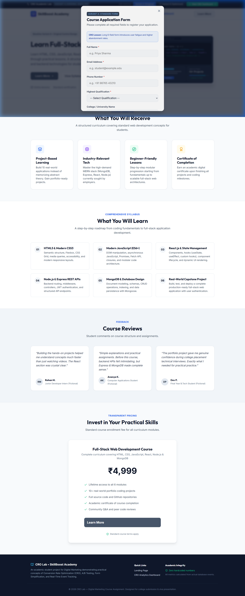
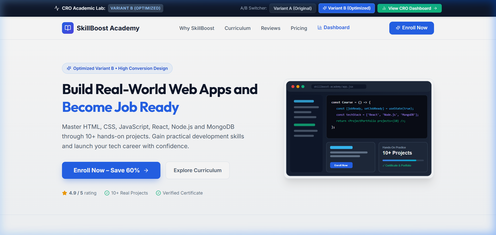
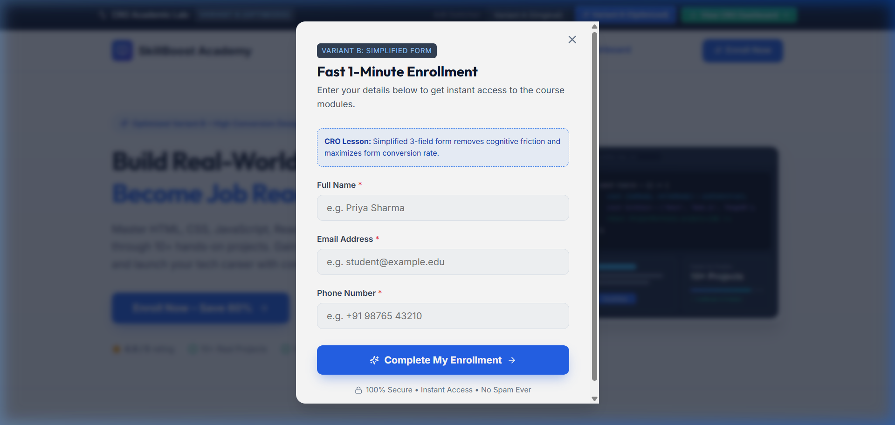
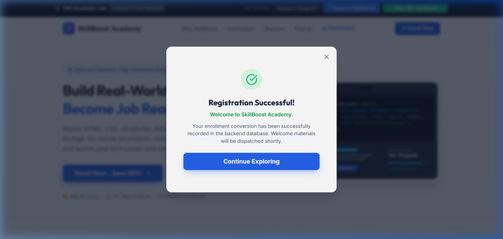
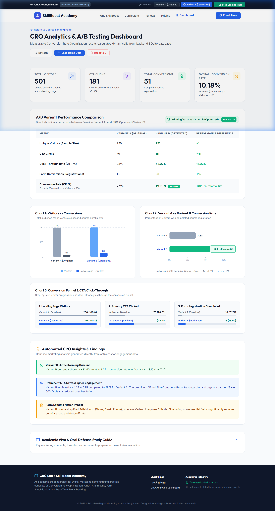
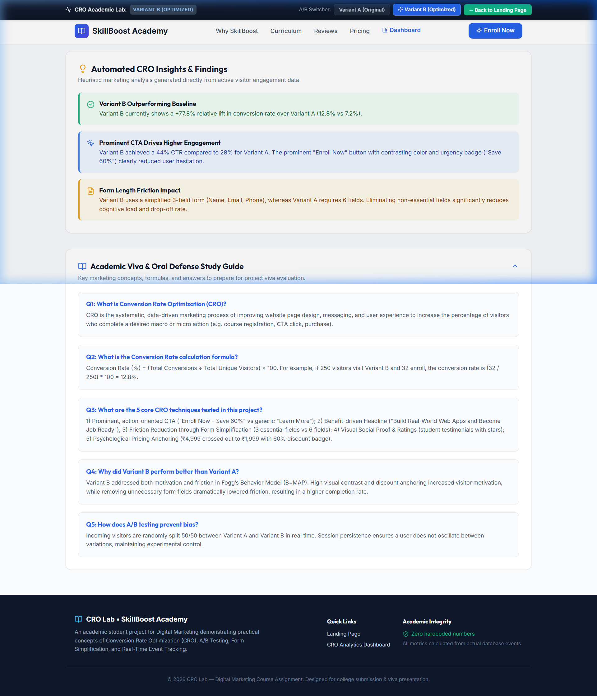

# CRO Lab – Conversion Rate Optimization & A/B Testing Platform

[](https://nodejs.org/)
[](https://reactjs.org/)
[](https://vitejs.dev/)
[](https://www.sqlite.org/)
[]()

> **Academic Project for Digital Marketing Course**  
> **Repository Name:** `cro-digital-marketing`  
> **Project Name:** CRO Lab – Conversion Rate Optimization & A/B Testing Platform  

---

## 📖 Introduction to CRO

**Conversion Rate Optimization (CRO)** is the systematic, data-driven marketing discipline of optimizing website design, layout, content, and user experience to increase the percentage of visitors who complete a desired marketing goal (such as enrolling in a course, signing up for a newsletter, or purchasing a product).

In digital marketing, gaining web traffic through search ads (Google Ads), social campaigns, or SEO requires substantial budget and effort. CRO focuses on maximizing the value of **existing** traffic by removing cognitive friction, improving persuasive copy, and simplifying user actions.

---

## 🎯 Project Objective

**CRO Lab** is an interactive, full-stack web application developed to demonstrate practical CRO concepts in an academic setting. Rather than displaying simulated or fake numbers, this project features an actual landing page for an imaginary course provider (**SkillBoost Academy**) paired with an active **Express + SQLite** event-tracking backend and an interactive **CRO Analytics Dashboard**.

The application demonstrates these core CRO principles:
- **Clear Call-to-Action (CTA)**: Action-driven vs. passive buttons.
- **Visual Hierarchy & Contrast**: Guiding visitor attention to high-value areas.
- **Form Simplification**: Demonstrating the impact of friction on drop-off.
- **Social Proof**: Trust architecture using ratings and student reviews.
- **Psychological Price Anchoring**: Demonstrating perceived savings.
- **A/B Split Testing**: Measuring performance between a control and an optimized variation.
- **Real-Time Conversion Tracking**: Tracking page views, CTA clicks, and form completions.
- **Conversion Rate Calculation**: Dynamic mathematical computation with zero-division safety.

---

## 📸 Screenshots

| 1. Baseline Variant A (Friction Form) | 2. Optimized Variant B (High CRO) |
|---|---|
|  |  |

| 3. Simplified 3-Field Modal (Low Friction) | 4. Registration Success Confirmation |
|---|---|
|  |  |

| 5. Live CRO Analytics Dashboard | 6. Viva Study & Oral Defense Guide |
|---|---|
|  |  |

---

## 🧪 A/B Testing Implementation

The platform randomly assigns visitors to one of two variations via a 50/50 split and maintains session persistence:

```
                              ┌──▶ Variant A (Original Baseline: 50% Traffic)
Incoming Visitor ──▶ Randomizer
                              └──▶ Variant B (CRO-Optimized: 50% Traffic)
```

### Detailed Comparison Between Variants

| Marketing Element | Variant A (Original Control) | Variant B (CRO-Optimized) | CRO Marketing Rationale |
|---|---|---|---|
| **Headline** | *"Learn Full-Stack Development"* | *"Build Real-World Web Apps and Become Job Ready"* | Benefit-focused headline resonates with career aspirations. |
| **Primary CTA** | *"Learn More"* (Subdued Slate) | *"Enroll Now – Save 60%"* (Vibrant Royal Blue) | High contrast + explicit action verb + clear value proposition. |
| **Form Length** | 6 fields (Name, Email, Phone, Qualification, College, Goals) | 3 fields (Name, Email, Phone) | Minimizes cognitive friction and form abandonment. |
| **Social Proof** | Standard text cards near bottom | 5-star rating badges + student avatar tags | Reassures prospects and reduces purchase anxiety. |
| **Pricing** | ₹4,999 (plain price) | ₹4,999 crossed out $\to$ **₹1,999** (60% OFF) | Price anchoring establishes high value with urgent discount. |
| **Trust Badges** | Minimal standard text | 7-day money-back guarantee + verified certificate tag | Risk-reversal mechanism reassuring the user. |

---

## 📐 Conversion Rate Formula & Mathematical Logic

The system calculates real-time conversion rates directly from database records:

$$\text{Conversion Rate (\%)} = \left( \frac{\text{Conversions}}{\text{Visitors}} \right) \times 100$$

$$\text{Click-Through Rate (\%)} = \left( \frac{\text{CTA Clicks}}{\text{Visitors}} \right) \times 100$$

$$\text{Relative Lift (\%)} = \left( \frac{\text{CR}_B - \text{CR}_A}{\text{CR}_A} \right) \times 100$$

> **Zero Division Handling:** If visitors = 0, the backend returns `0.0%` to prevent `NaN` or unhandled runtime exceptions.

---

## 🏗️ System Architecture

```
[ Frontend: React + Vite ] 
         │
         │ HTTP JSON (Proxied via Vite)
         ▼
[ Backend: Node.js + Express.js ] ── (Controllers / Validation / Routes)
         │
         │ Prepared Statements (better-sqlite3 / node:sqlite)
         ▼
[ Database: SQLite (cro_database.sqlite) ]
  ├── events (session_id, variant, event_type, cta_name, timestamp)
  └── conversions (session_id, variant, name, email, phone, timestamp)
         │
         │ Aggregated Metrics & Lift Calculations
         ▼
[ CRO Analytics Dashboard (/dashboard) ]
  ├── KPI Cards (Total Visitors, Clicks, Conversions, Overall CR)
  ├── A/B Comparison Table (Side-by-Side Breakdown & Winner)
  ├── SVG Charts (Visitors vs Conversions, CR %, Funnel Drop-off)
  └── Dynamic CRO Insights & Viva Guide
```

---

## 🛠️ Tech Stack

- **Frontend**: React 18, Vite 5, JavaScript (ES6+), Vanilla CSS (custom design system, zero bloated CSS frameworks), Lucide React (clean SVG icons).
- **Backend**: Node.js, Express.js, CORS, Dotenv.
- **Database**: SQLite (via `better-sqlite3` with auto-fallback to native `node:sqlite`). Zero external database installation required!
- **Testing**: Built-in `node:test` and `node:assert` test suite.

---

## 🚀 Getting Started & Installation

### Prerequisites
- Node.js (v18, v20, v22, or v24)
- npm (v9+)

### Step 1: Clone Repository
```bash
git clone https://github.com/<your-username>/cro-digital-marketing.git
cd cro-digital-marketing
```

### Step 2: Install Dependencies
Install dependencies for both backend and frontend:
```bash
# Option A: Root script
npm run install:all

# Option B: Manual install
cd server && npm install
cd ../client && npm install
cd ..
```

### Step 3: Run the Application
Open two terminal windows:

**Terminal 1 (Backend Server):**
```bash
cd server
npm start
```
*Backend runs on: `http://localhost:5000`*

**Terminal 2 (Frontend Client):**
```bash
cd client
npm run dev
```
*Frontend runs on: `http://localhost:5173`*

---

## 🧪 Running Automated Tests

Run the backend test suite to verify event tracking, form validation, conversion recording, and zero-division mathematics:

```bash
cd server
npm test
```

### Test Suite Output:
```
▶ CRO Lab Backend API & Analytics Tests
  ✔ 1. API Health Check returns 200 and healthy status
  ✔ 2. Event Tracking: Records page_view and cta_click for Variant A and B
  ✔ 3. Event Tracking: Rejects invalid variant or invalid eventType
  ✔ 4. Form Validation: Rejects missing name, invalid email, or short phone
  ✔ 5. Conversion Recording: Successfully registers student and increments conversion event
  ✔ 6. Duplicate Prevention: Prevents accidental duplicate submission in same session
  ✔ 7. Analytics: Correctly calculates overall conversion rate without NaN or division by zero
  ✔ 8. A/B Variant Comparison: Tracks Variant A and B separately and calculates Lift & Winner
  ✔ 9. Seeding & Resetting: Seed fills mock data, reset resets everything to 0
✔ CRO Lab Backend API & Analytics Tests (9 passed, 0 failed)
```

---

## 📊 Demo Seed Data (For College Presentations)

During an academic presentation or viva, you may want to demonstrate a populated dashboard with realistic student numbers:

```bash
cd server
npm run seed
```

Or simply click the **"Load Demo Data"** button directly on the dashboard page (`/dashboard`). This inserts 250 visitors for Variant A and 250 visitors for Variant B with realistic drop-off numbers.

To start testing live clicks from zero, click **"Reset to 0"** on the dashboard.

---

## 🔌 API Endpoints Documentation

| Method | Endpoint | Description | Sample Payload |
|---|---|---|---|
| `GET` | `/api/health` | Health check endpoint | — |
| `POST` | `/api/events` | Record visitor interaction (`page_view`, `cta_click`) | `{"sessionId": "s1", "variant": "B", "eventType": "page_view"}` |
| `POST` | `/api/conversions` | Submit student enrollment form | `{"sessionId": "s1", "variant": "B", "name": "Priya", "email": "p@test.com", "phone": "9876543210"}` |
| `GET` | `/api/analytics` | Overall KPI summary | — |
| `GET` | `/api/analytics/variants` | A/B comparison metrics & winning variant | — |
| `GET` | `/api/analytics/funnel` | 3-stage funnel metrics for charts | — |
| `POST` | `/api/analytics/seed` | Seed demo data for presentations | — |
| `POST` | `/api/analytics/reset` | Reset all metrics to zero | — |

---

## 📚 Digital Marketing Viva Study Guide

An interactive **Viva Voce & Oral Defense Guide** is embedded directly into the dashboard. Key topics covered:
1. **What is CRO?** The process of turning existing traffic into conversions.
2. **Fogg's Behavior Model ($B = MAP$)**: Increasing motivation and ability while presenting a clear prompt.
3. **Friction vs. Motivation**: Why reducing form fields from 6 to 3 reduces cognitive load.
4. **Statistical Lift**: Understanding relative lift vs. absolute lift.
5. **Macro vs. Micro Conversions**: Tracking CTA clicks (micro) leading to enrollment (macro).

---

## 🔮 Future Enhancements

- **Heatmap Integration**: Visualizing click density and scroll depth (e.g., Hotjar or Microsoft Clarity).
- **Statistical Significance Engine**: Calculating $p$-values and confidence intervals ($95\%$ confidence).
- **Multivariate Testing (MVT)**: Testing combinations of headlines, button colors, and layouts simultaneously.
- **Audience Segmentation**: Tracking conversions by device type (mobile vs. desktop) and traffic source.

---

## 📄 License & Attribution

This project was developed strictly for academic purposes as part of a **Digital Marketing** course assignment on Conversion Rate Optimization. Fictional brand name, testimonials, and course content are used for demonstration.

**License:** MIT
